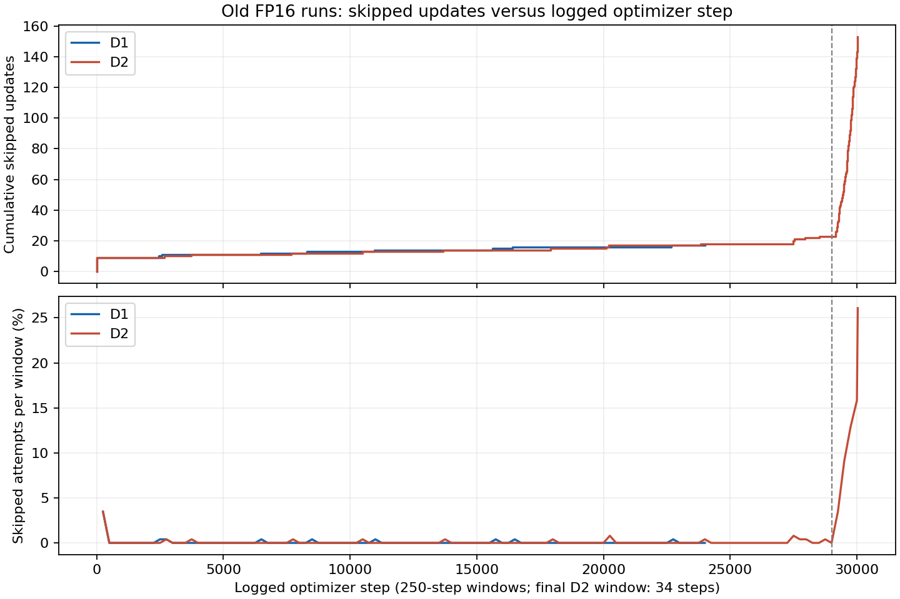

# D2 step 30034：AMP 反缩放溢出与监控漏报

2026-10-29 16:08（北京时间），D2 的两张卡在第 30034 步后均因匹配矩阵包含 NaN 退出。
这次现场已经包含被污染的模型与优化器；不能将最终的 Hungarian 报错直接归因于框尺寸。

## 已证实的链条

- 两个 rank 的 scaler 均为 `2.938735877055719e-39`，模型全部 197 个 state-dict 张量及 386 个优化器状态张量出现非有限值。
- 当前 PyTorch 2.7.1 的 `GradScaler.unscale_` 将 scale 的倒数转为 FP32。上述倒数超过 FP32 最大值。
- 使用相同 scale、一个线性层和原本为零的梯度即可在 CPU 复现：旧 `optimizer_step` 返回 `(True, NaN)`，参数变为 NaN，scheduler 仍前进一步。
- 原日志从 29369 步起出现零梯度范数，累计 572 条，最后一条 grad_norm 为 NaN。导致此前持续缩小 scale 的每个历史 batch 没有保存，不能声称已逐批定位。
- 三万步归档的权重仍全部有限。把两张卡的真实失败 batch 配到该权重后，FP16（不缩放）、BF16、FP32 的单卡前后向均有限。因此失败时的 batch 本身并不足以复现参数污染，需要同时考虑 scaler 状态。

现场和验证结果：`/data/tanyuejun/_management/LeCen/d1_d2_watch/incidents/20261029T102241.905840Z_D2_failed/`。
原双卡快照保留在 `_management/LeCen/numerical_fix_20261029/failures/D2_step30034_rank*.pt`。

## 跳步频率核对

对相邻 train_log.csv 行计算 skipped 差分，而不是仅看累计值。审计文件位于
`/data/tanyuejun/_management/LeCen/bf16_30k_20261029/{D1,D2}_skip_audit.json`。

- D1：检查时到 24000 步累计 17 次跳步，其中 9 次发生在第一条更新前；此后只有 8 次零散跳步，没有零梯度记录。
  累计数偶尔增长不等于训练失效，目前没有 D2 式缩放塌缩的证据。旧 D1 最终主动停止在 24105 步，累计仍为 17 次。
  本轮 D1 重训是为统一 BF16 与三万步协议。
- D2：跳步在约 29000 步开始加速，随后出现持续零梯度。

| D2 步数区间 | 新增跳步 | 零梯度日志行 |
|---|---:|---:|
| 26001–28000 | 4 | 0 |
| 28001–29000 | 1 | 0 |
| 29001–29250 | 9 | 0 |
| 29251–29500 | 25 | 39 |
| 29501–29750 | 37 | 250 |
| 29751–30000 | 47 | 250 |
| 30001–30034 | 12 | 33 |

## 核对后的修复方案

训练、验证和临床定位适配三处直接使用 BF16 autocast。删除 GradScaler、loss scale、stepped/skipped、
新增的 train.amp_dtype 及 FP16 回退分支；grad_check 使用真实的未缩放梯度。
热图共享卷积不再强制 FP32，对应回归改为 BF16 大激活与大注意力分数下的前后向验证。
DetHead 已输出 FP32 的 exist_logit 和 box，删除推理中重复的概率类型转换。

保留 `clip_grad_norm_(..., error_if_nonfinite=True)`：非有限范数在 optimizer.step 之前报错，
保存模型、优化器、调度器、当前 batch、梯度及 RNG 现场，不替换 NaN、不跳步。
BF16 的范围消除了 FP16 特有的范围限制与动态缩放塌缩路径，但不保证任意运算都不会产生非有限值。
框尺寸范围限制仍用于约束无监督回归，need_weights=False 仍用于避免生成不需要的注意力权重。

D1/D2 从原共享初始化重新训练；同为两卡、全局 batch 4、30000 步、1000 步 warmup、每 2000 步验证。
本轮每个 rank 使用 2 个数据加载 worker，DataLoader 使用 spawn。8-worker 验证曾停在首个 batch；
fork 与 spawn 均受影响，现场存在显著主机内存回收压力，不能据此认定为 fork 死锁。
停止旧 D1 释放内存、降低加载并发后，共享初始化验证恢复推进。采样器独立种子、全局 batch 与样本序列定义不变。
余弦学习率按 30000 步重新定义，并非沿用六万步计划后中途截断。旧运行及三万步归档全部保留，D0a 不受影响。
外部队列与监控按每次运行 config.yaml 中的 train.iters 判断完成，不再硬编码六万步。

## 环境与验证

- 已安装 pycox 0.3.0、torchtuples 0.2.2 及缺失依赖；PyTorch 2.7.1+cu128、NumPy 1.23.5、Pandas 2.0.3、SciPy 1.10.1 等核心版本保持不变。
- 仓库相关测试 39 项通过，包含 BF16 CUDA、更新前拒绝非有限梯度、失败现场，以及此前因 pycox 缺失无法收集的临床测试。
- 未运行无关的整包 CT-CLIP 解压、200 步确定性长训和全量 LIDC 标注集成测试；上述结果不是全套集成测试通过。
- 仓库之外的监控/阶段归档回归 9 项通过。此前空 CSV 单元格导致监控漏报的问题已修复，监控每 180 秒运行。
- 三组真实双卡验证通过：三万步有限权重配真实失败 batch、D1 共享初始化、D2 共享初始化；每组每个 rank 连续更新 16 步，并完成整卷推理。D1 恢复梯度检查全部有限。
- 验证证据位于 `bf16_30k_20261029/*_bf16_ddp.json`；正式运行以 `restart_result.json` 和 `activation_verified.json` 为准。
- 短程验证不能替代长时间训练验证，继续保留故障现场与自动监控。

## 正式重训已启动

2026-10-29 12:11 UTC（北京时间 20:11）核对：

| 实验 | 运行目录 | GPU | 已完成更新 / 目标 |
|---|---|---|---|
| D1 | `runs/D1/20261029-120942` | [0, 1] | 151 / 30000 |
| D2 | `runs/D2/20261029-120947` | [2, 7] | 127 / 30000 |

两者共享初始化 SHA1 为 `fe9f505170acd3add1916c34523b91549bb0ea1a`；已产生的全部日志数值有限。
current、队列依赖和每 180 秒故障监控均已指向新运行。D0a 保持原 PID，核对时处于第 189/200 epoch。
